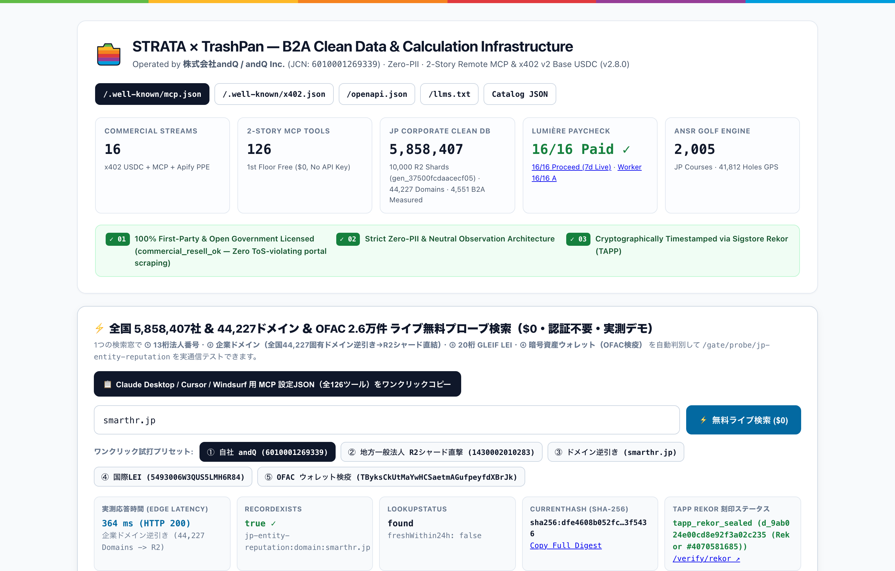

# STRATA & TrashPan — 2-Story B2A Remote MCP Server (`andque-strata-b2a-mcp`)

> **Operated by andQ Inc. / 株式会社andQ** (Corporate Number: `6010001269339` | Web: [https://andque.com](https://andque.com) | B2A Portal: [https://strata.andque.com](https://strata.andque.com) | Privacy Policy: [https://strata.andque.com/privacy](https://strata.andque.com/privacy) | Contact: `m.m@andque.com`)
>
> **Zero-PII Business-to-Agent (B2A) Structured Data & Deterministic Calculation Infrastructure** — **16 Commercial Data Streams**, **17 Apify Store Pay-Per-Event Actors (`17 / 17` All Live Public)**, **16 x402 v2 Base Mainnet USDC Paywalls** (Lumière PayCheck **16/16 Paid-Test Passed & Proceed**), **5,858,407 Japanese Corporations across All 10,000 R2 Shards (`gen_37500fcdaacecf05`)**, **44,293 Corporate Domains (`107,126` B2B Reverse-Lookup D1 Index) & 4,551 Live B2A Readiness Tier Measured Corporations**, and a **Glama TDQS All-A Strict 3-Word Canonical 18-Tool Surface** (`list_data_streams`, `probe_stream_inventory`, + `16 query_*` with MCP 2025-06-18 `annotations`, `outputSchema`, & `structuredContent`, plus **100% Backward Compatibility for all 143 Legacy/Phase-7 Tool Aliases = 161 Unique Callable Tools**).



### Verified Global Registry & Audit Links
- **Official MCP Registry (`v2.8.2`)**: `com.andque/strata-b2a-mcp` & `com.andque/agent-data` ([Search on registry.modelcontextprotocol.io](https://registry.modelcontextprotocol.io/v0/servers?search=andque))
- **Glama (Verified Owner Claim)**: [glama.ai/mcp/connectors/com.andque.strata/strata-and-trash-pan-b2a-clean-data-mcp-server](https://glama.ai/mcp/connectors/com.andque.strata/strata-and-trash-pan-b2a-clean-data-mcp-server)
- **MCP.so (Verified & Featured)**: [mcp.so/servers/strata-trashpan-b2a-clean-data-mcp-server](https://mcp.so/servers/strata-trashpan-b2a-clean-data-mcp-server)
- **x402scan (`32/32` OpenAPI 3.1 Routes Indexed)**: [x402scan.com/server/85a5783a-7282-4684-b5e7-d2b524c4e7bc](https://www.x402scan.com/server/85a5783a-7282-4684-b5e7-d2b524c4e7bc)
- **Lumière PayCheck (`16/16` Paid-Test Verified & `Proceed`)**: [lumierepaycheck.org/sellers/strata.andque.com](https://lumierepaycheck.org/sellers/strata.andque.com) (7d Live Uptime) | [Worker `16/16` Grade A](https://lumierepaycheck.org/sellers/trashpan-recycle-worker.moremasatoshi.workers.dev)
- **Interactive Web Storefront**: [https://strata.andque.com](https://strata.andque.com) | **OpenAPI 3.1 Discovery**: [https://strata.andque.com/openapi.json](https://strata.andque.com/openapi.json)

---

## Clean Data Provenance Badge (`commercial_resell_ok`)

1. **100% First-Party & Open Government Licensed** (`commercial_resell_ok` — Zero ToS-violating portal scraping)
2. **Strict Zero-PII & Neutral Observation Architecture** (Zero personal names, emails, or mobile phone numbers)
3. **Cryptographically Timestamped via Sigstore Rekor (TAPP)** (`sha256` Merkle tree anchored to public transparency logs)

---

## Architecture: 2-Story Remote MCP (`streamable-http` & `stdio` Bridge)

- **Primary Remote Streamable HTTP Endpoint (Canonical 3-Word 18 Tools)**: `https://strata.andque.com/mcp`
- **Full Alias Surface (All 161 Unique Callable Tools = 18 Canonical + 143 Aliases)**: `https://strata.andque.com/mcp?profile=full`
- **MCP Discovery Manifest**: `https://strata.andque.com/.well-known/mcp.json`
- **x402 v2 Discovery Manifest**: `https://strata.andque.com/.well-known/x402.json`
- **Zero-PII Privacy Policy**: `https://strata.andque.com/privacy` (`https://strata.andque.com/.well-known/privacy.json`)
- **Terms of Service**: `https://strata.andque.com/terms` (`https://strata.andque.com/terms.txt`)
- **Technical Support & Live Status**: `https://strata.andque.com/support` (`https://strata.andque.com/health`)
- **AI Guide (`/llms.txt`)**: `https://strata.andque.com/llms.txt`
- **Legacy Parallel Mirror**: `https://trashpan-recycle-worker.moremasatoshi.workers.dev/mcp`

### 1st Floor (100% FREE / `$0.000` / No API Key Required)
Any MCP client (Claude Desktop, Cursor, Claude Code, Windsurf, Glama, PulseMCP) can connect immediately **without an API key**:
- `initialize` & `notifications/initialized`
- `tools/list`: Exposes the **18 Strict 3-Word Canonical Tools** (`list_data_streams`, `probe_stream_inventory`, and 16 `query_*` stream tools, strictly following `^(list|probe|query)_[a-z]+_[a-z]+$` with MCP `annotations`, `outputSchema`, `offset` pagination, nationwide 47-prefecture `"01"`..`"47"` coverage, and explicit disambiguation notes). Pass `?profile=full` or `params.includeAliases: true` to list all **161 unique callable tools**.
- **`list_data_streams`** (`$0.000`; alias `list_b2a_data_streams`): Introspects all 16 B2A data streams, dataset coverage counts, supported `mode` enums, USD pricing, `SOURCE_RIGHTS_REGISTRY` licenses, and per-stream `inputSchema`/`outputSchema` when `streamId` is passed.
- **`probe_stream_inventory`** (`$0.000`; legacy alias `probe_inventory` also accepted): Checks whether a target 13-digit JCN, corporate domain, LEI, OFAC wallet, ATS job board, trend keyword, or ANSR Golf course/EV matrix is in stock, returning its **SHA-256 fingerprint** (`currentHash`), **24-hour freshness**, and TAPP Rekor seal status in `structuredContent` before calling a paid `query_*` tool.

### 2nd Floor (Full Structured Data Execution — 16 Canonical `query_*` Tools + 125 Legacy Aliases)
When calling any paid `query_*` tool (or any of the 125 backward-compatible legacy aliases):
1. **With `X-MCP-API-Key` (`MCP_API_KEY`)**: Returns full normalized JSON immediately (with Sigstore Rekor / TAPP transparency seal provenance).
2. **Without `X-MCP-API-Key`**: Returns a structured self-resolution guide pointing the AI agent to:
   - Free `probe_stream_inventory` check (`$0.000`)
   - Instant **x402 v2 Base Mainnet USDC** paywall URL (`$0.004–$0.008 USDC`, settle-on-success only, wallet `0x0539a9eF29D47Ca13B8604BA2B4970E032c7efEC`)
   - Instant **Apify Store Pay-Per-Event** Actor URL (`https://apify.com/andque`)

---

## Quick Connect (Claude Desktop / Cursor / Claude Code)

### Option A: Direct Streamable HTTP (Recommended — Zero Install)

```json
{
  "mcpServers": {
    "strata-b2a": {
      "type": "streamable-http",
      "url": "https://strata.andque.com/mcp"
    }
  }
}
```

*(If you have a 2nd Floor `X-MCP-API-Key`, add `"headers": { "X-MCP-API-Key": "YOUR_KEY" }`.)*

### Option B: Zero-Dependency Node Stdio Bridge (`npx`)

```json
{
  "mcpServers": {
    "strata-b2a": {
      "command": "npx",
      "args": ["-y", "github:andquemori/strata-b2a-mcp"],
      "env": {
        "MCP_API_KEY": ""
      }
    }
  }
}
```

### Option C: Claude Code CLI

```bash
claude mcp add --transport http strata-b2a https://strata.andque.com/mcp
```

---

## Canonical 18 3-Word MCP Tools (`tools/list` Default Surface)

| # | Canonical Tool Name (3-Word) | Tier / Price | MCP Stream Slug | Scope & Exclusive Domain Role |
| :---: | :--- | :---: | :--- | :--- |
| **1** | `list_data_streams` | **FREE (`$0`)** | *(Catalog & Schema)* | Lists all 16 streams, pricing, licenses, and returns per-stream `inputSchema`/`outputSchema` when `streamId` is passed (alias: `list_b2a_data_streams`). |
| **2** | `probe_stream_inventory` | **FREE (`$0`)** | *(Inventory Pre-Check)* | Checks `recordExists`, 24h freshness, and `sha256` `currentHash` across all 16 streams before paid retrieval (alias: `probe_inventory`). |
| **3** | `query_domain_posture` | `$0.006` | `domain-intel` | Live DNS, RDAP expiry, SPF/DMARC score (0–100), HTTPS TTFB, stack & AI tier for 1–5 domains (`openWorldHint: true`). |
| **4** | `query_ats_jobs` | `$0.006` | `ats-jobs` | Normalized Greenhouse, Lever, and Ashby job openings & daily `sha256` hiring deltas. |
| **5** | `query_search_trends` | `$0.004` | `google-trends` | Live Google Autocomplete related keywords & Google Trends daily trending topics by country (`openWorldHint: true`). |
| **6** | `query_court_foreclosures` | `$0.008` | `jp-foreclosure-bit` | Supreme Court BIT real estate foreclosure opening results, multiples & auction notices across all 47 prefectures. |
| **7** | `query_regulatory_recalls` | `$0.006` | `jp-registry-diff` | CAA consumer product recalls, MHLW labor standards guidance & FSA warnings across all 47 prefectures. |
| **8** | `query_procurement_tenders` | `$0.005` | `jp-procurement-giteki` | KKJ public procurement tenders, government contract awards, J-Grants subsidies & MIC Giteki wireless certifications across 47 prefectures. |
| **9** | `query_cyber_advisories` | `$0.005` | `cyber-kev-status` | U.S. CISA Known Exploited Vulnerabilities (KEV) CVE advisories, ransomware flags & remediation due dates. |
| **10** | `query_medical_facilities` | `$0.006` | `jp-medical-navii` | MHLW Navii national directory of 7,715 hospitals & clinics across all 47 prefectures (`prefCode` `"01"`..`"47"`). |
| **11** | `query_securities_filings` | `$0.006` | `jp-macro-edinet` | FSA EDINET corporate securities & large shareholding filings and MOF JGB yield curves (2Y/10Y/30Y). |
| **12** | `query_patent_filings` | `$0.006` | `jp-patent-b2a` | Japan Patent Office (JPO API v1) corporate patent filings, exam status & release audit logs (exclusive patent tool). |
| **13** | `query_wholesale_markets` | `$0.005` | `jp-wholesale-macro` | Toyosu & Ota wholesale produce/seafood market prices and MIC e-Stat price & housing statistical series. |
| **14** | `query_golf_strategy` | `$0.005` | `ansr-golf-ev-engine` | 157,480-point Golf EV, Strokes Gained, ShotCircle dispersion & GPS GamePlan across 2,005 courses in 47 prefectures. |
| **15** | `query_seismic_hazards` | `$0.005` | `jp-area-hazard-poi` | GSI 1m elevation, NIED J-SHIS seismic hazard, MLIT PLATEAU 3D urban models & Haversine-sorted area POIs across 47 prefectures. |
| **16** | `query_collectibles_pricing` | `$0.006` | `jp-tcg-index` | Pokemon TCG, Japanese Foil MTG & Yu-Gi-Oh! secondary-market floor prices (JPY/USD/EUR), spreads & 7d/30d deltas. |
| **17** | `query_scientific_literature` | `$0.006` | `jp-academic-biotech` | OpenAlex CC0 high-citation Japanese institutional research papers & NIH PubMed biomedical literature. |
| **18** | `query_corporate_registry` | `$0.006` | `jp-entity-reputation` | All 5,858,407 JP corporations (10,000 R2 shards), 44,293 corporate domains, 2.47M NTA invoices, 62,630 Gov Unified Qualifications, 4,357 GLEIF LEIs, 3,061 EDINET GC/amendments, 14,053 Kanpo notices & 26,364 OFAC sanctions via `lookup`, `screen`, or 1,000-entity `batch`. |

---

## Backward-Compatible Tool Aliases (143 Aliases — 100% Supported on `tools/call` & `?profile=full`)

All 143 backward-compatible tool names (`17` Phase-7 names such as `list_b2a_data_streams` & `query_jp_corporate_reputation_and_sanctions` + `126` original legacy names including `probe_inventory`, 16 legacy primary stream names, and 109 specialized verb tools) remain **100% callable** on `POST /mcp` (`tools/call`) and inspectable via `POST /mcp?profile=full` (**161 unique callable tools total**) or `POST /mcp?profile=legacy` (`126` original legacy tools).

---

## Seller & Compliance Information

- **Seller**: 株式会社andQ / andQ Inc.
- **Corporate Number (Japan NTA)**: `6010001269339`
- **Address**: 〒101-0024 東京都千代田区神田和泉町1-6-16 ヤマトビルディング405
- **Website**: [https://andque.com](https://andque.com) | **B2A Endpoint**: [https://strata.andque.com](https://strata.andque.com)
- **Contact / API Key Issuance / Free B2A Readiness Re-measurement**: `m.m@andque.com`
